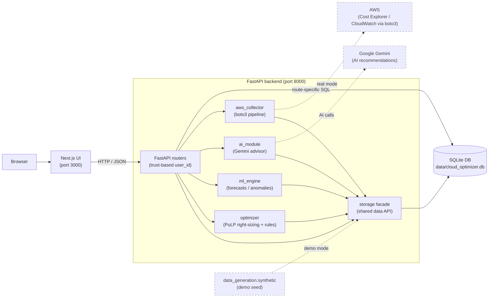

# Smart Cloud Optimizer (OptiCloud)

Next.js UI + FastAPI backend for AWS cost collection, forecasting, anomaly detection, and optimization. Recommends changes; never applies them.

App work targets **`main`**. Default `release/ccpe-v1.0` is a separate paper artifact:
`git clone --branch main https://github.com/G1DO/smart-cloud-optimizer.git`

> Single-user localhost + synthetic data only.
> HTTP trusts client `user_id`; AWS keys stored plaintext in SQLite.
> Read `docs/security/threat-model.md` before connecting a real account.

## Prerequisites

Python 3.12+, Node 20.9+, npm, Git. Docker + Compose for containers.
Python pins: `requirements.txt`. Frontend pins: `frontend/package.json` + `frontend/package-lock.json`.
Templates: `.env.example`, `.env.docker.example`, `frontend/.env.local.example`.

## Run — Docker

```bash
docker compose up --build
# docker compose --profile full up --build  # adds legacy Streamlit on :8501
```

Frontend http://localhost:3000 · API docs http://localhost:8000/docs · liveness http://localhost:8000/health · readiness http://localhost:8000/ready.
DB in named volume `optimizer-data`; `down -v` destroys it. `NEXT_PUBLIC_API_BASE_URL` is a frontend build arg, must be host-reachable (`http://localhost:8000`).

```bash
cp .env.docker.example .env  # only for Gemini / real AWS
```

## Run — manual

```bash
python3 -m venv venv && source venv/bin/activate
pip install -r requirements.txt
cp .env.example .env  # optional
uvicorn backend_api.main:app --reload --host 127.0.0.1 --port 8000
cd frontend && npm ci && cp .env.local.example .env.local && npm run dev -- --hostname 127.0.0.1
```

## First use

Open http://localhost:3000 → Try Demo Mode (`aws-SYNTHETIC-001`). New users start empty.
Connections: Test and Save are separate — save with supplied account ID does not re-verify keys; sync can still fail. Sync clears prior account data then collects newest-month-first incrementally. Forecasts via UI/API. Optimizer: run on disposable DB copy, see `optimizer/engine.py`.

## Verify

```bash
python3 -m pip check
python3 -m pytest tests/ -v
git diff --check
gitleaks detect --source . --config .gitleaks.toml --verbose
cd frontend && npm ci && npm run lint && npm run build
```

`/health` = liveness cheap. `/ready` = readiness with DB check (503 when down).
OpenAPI without server: `python3 -c "from backend_api.main import app; import json; print(json.dumps(app.openapi(),indent=2))"`.
Same checks run in CI `verify` job, required for merge. Verbs: `pyproject.toml [tool.poe.tasks]`, `Makefile`.

## Security

- No tokens: login verifies PBKDF2 hash, issues nothing; all data routes trust `user_id` query — localhost only.
- AWS keys plaintext in `storage/db.py`; API exposes last 4 only; save ≠ verified.
- Tracked `data/cloud_optimizer.db` contains real PII + account ID/ARN + synthetic demo — add nothing real, distribute no rebuilt images with real data.
- AI: prompt >4000 → 400, Gemini fail → 502, optional `ONBOARDING_API_TOKEN`; advice unvalidated.
- Browser identity `localStorage` only; settings `backend_api/runtime_settings.json` unwired to engines, lost on recreate. Reports: `SECURITY.md` private only.

## Architecture



Code is canonical. Diagrams: Mermaid `.mmd` validated with mermaid-cli, Excalidraw never canonical.

| View | Source |
|---|---|
| Context | `docs/architecture/c1-system-context.mmd` |
| Containers | `docs/architecture/c2-containers.mmd` |
| Components | `docs/architecture/c3-components.mmd` |
| Sequence | `docs/architecture/sequence.mmd` |
| State | `docs/architecture/state.mmd` |
| Deployment | `docs/architecture/deployment.mmd` |
| Data model | `docs/architecture/data-model.md` — generator from `storage/db.py`, additive `ensure_schema` |

`storage/` is preferred facade but forecast/recommendation/connection routes also issue direct SQL. Identity: `usr-…` on register, web save switches to `aws-<account_id>`; legacy Streamlit stays on `usr-…`.

Active env: `GOOGLE_API_KEY`, `GOOGLE_MODEL`, `ONBOARDING_API_TOKEN`, `NEXT_PUBLIC_API_BASE_URL`, `AWS_DEFAULT_REGION`, `DEMO_MODE`. See `cloud_optimizer/config.py`, `aws_collector/config.py`, `docker-compose.yml`.

## Operations

Single-user localhost. No prod, no SLO, no on-call. `docs/operations/runbook.md` absent until prod.

| Symptom | Check |
|---|---|
| Empty dashboard | Workspace selected? Demo data only in `aws-SYNTHETIC-001` |
| Sync 409 | Stale `in_progress` — stop writers, set `failed` via `storage.update_aws_connection_status`, restart, retry |
| AI 502 / settings no-op | Key set? Logs? Settings are prefs, not engine inputs |

Preserve: SQLite backup API to temp dir outside repo, `integrity_check` ok, keep WAL/SHM with DB, never commit snapshots. Restore: stop writers, preserve current + sidecars, restore verified snapshot, verify workspace/dates. `down -v` destroys compose volume — preserve first.

Engines: `optimizer/engine.py` (PuLP + rules, replaces per-user recs), `ml_engine/forecaster.py` (30d default, 1–180d, null-on-fail), `ai_module/recommender.py` (questionnaire → Gemini, router does not persist). Collection: `aws_collector/runner.py` newest-first.

## Index

| Need | Go here, not a copy |
|---|---|
| Run/verify | This file; `pyproject.toml`, `Makefile`, `.github/workflows/verify.yml` |
| HTTP | `backend_api/main.py`, `backend_api/routers/`, live `/docs` |
| Storage/schema | `storage/db.py`, `storage/__init__.py`, `docs/architecture/data-model.md` |
| Decisions | `docs/decisions/` |
| Security | `docs/security/threat-model.md`, `SECURITY.md`, `CODEOWNERS` |
| Changes | `CONTRIBUTING.md`, `.github/pull_request_template.md` |
